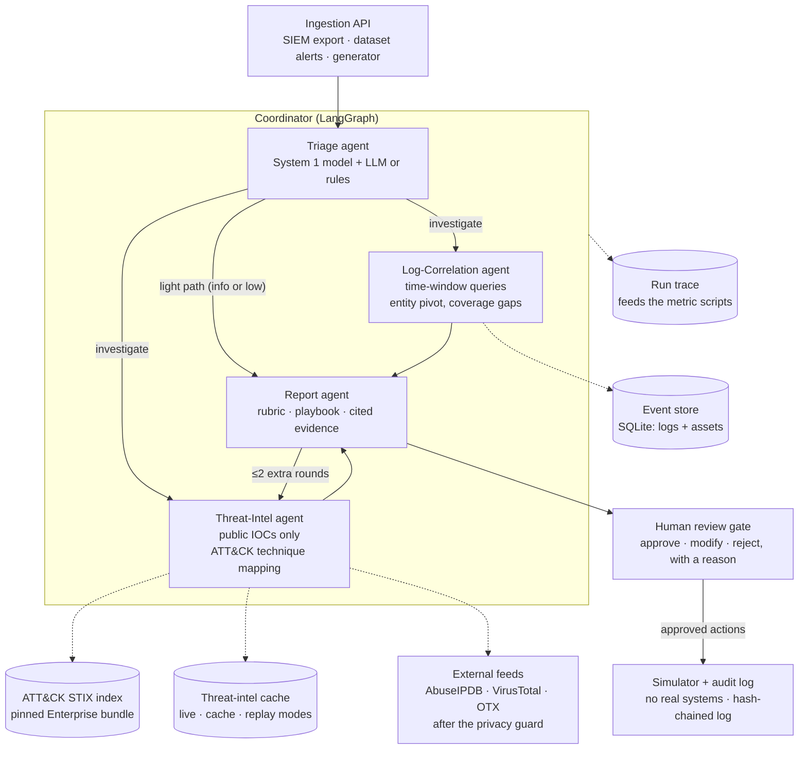

# Multi-Agent SOC Analyst — System Architecture Design

Nov 24, 2026

## Purpose and scope

This document fixes the target architecture of the Multi-Agent SOC Analyst. It includes the system architecture, agent role definitions, orchestration protocol and dataset shortlist.

It describes the system to be built. Section 11 maps it against the code that exists today.

**In scope:** alert ingestion, the five agents (Coordinator, Triage, Log-Correlation, Threat-Intel, Report), log storage, threat-intel and MITRE ATT&CK integration, the human approval gate, the analyst dashboard and the hooks needed to measure the five evaluation metrics.

**Out of scope:** real response actions against live infrastructure (all actions are simulated), production SIEM connectors, multi-tenant deployment and user authentication beyond a reviewer ID.

The alert taxonomy, severity rubric and all requirements are in the [Requirements Specification](requirements-specification.md); this design implements them.

## Design goals and constraints

Eight principles drive every later choice. Where two conflict, the higher row wins.

| # | Goal | What it means in the design |
| --- | --- | --- |
| 1 | Safety first | No action runs without a human approval. Every action is simulated. High-risk actions need evidence from at least two log sources. |
| 2 | Evidence-grounded | Every claim in a report cites a log row or a threat-intel response by ID. An agent may not state a fact it did not retrieve. |
| 3 | Privacy | Internal IPs, hostnames and usernames never leave the system. Only public IPs, domains and file hashes go to external feeds. |
| 4 | Reproducible | Any run can be repeated exactly: recorded threat-intel responses, pinned dataset versions, fixed random seeds, a rebuildable database. |
| 5 | Works offline | The whole pipeline runs with no API keys, using deterministic fallbacks and replayed threat intel. LLMs add quality, not function. |
| 6 | Measurable | Every agent step is traced with inputs, outputs, tool calls and timings, so all five spec metrics can be computed from logs. |
| 7 | Explainable | Each agent emits a short reasoning summary. The analyst sees why, not just what. |
| 8 | Low cost | Small or local models for triage. LLM calls only where they add value. Free API tiers for threat intel. |

## System overview

An alert flows top to bottom through one Coordinator-run graph, and nothing leaves it without passing the human review gate.

Informational and Low alerts take a light path to a short report unless a safeguard fires. Everything else gets log correlation and threat intel in parallel, with up to two extra rounds when the report finds a gap. The services on the right are the only places agents read from or call out to.

## Agent roles

Five agents share the work: one Coordinator that plans and routes, and four specialists that each own one question. Every agent follows the same pattern: an LLM with bound tools when a key is configured, a deterministic fallback when not, and a typed Pydantic output either way.

| Agent | Question it answers | Inputs | Tools it may call | Output contract |
| --- | --- | --- | --- | --- |
| Coordinator | Which agents should run next, and is the evidence enough to stop? | Alert, all findings so far | None (routes only) | `InvestigationPlan`: agents to run, log sources, stop or continue |
| Triage | Is this likely real, what category, how urgent? | Normalised alert | `extract_iocs`, `lookup_asset`, `classify_alert` (System 1 model) | `TriageResult`: one of 10 categories, disposition (TP, BTP, FP or needs investigation), provisional severity, confidence, IOCs, light-or-full decision |
| Log-Correlation | What else happened around these IOCs? | Alert, IOCs, time window, log sources from the plan | `query_auth`, `query_network`, `query_endpoint`, `pivot_on_entity` | `CorrelationResult`: timeline of cited events, new IOCs found, sources covered and missing |
| Threat-Intel | Are the external IOCs known bad, and which ATT&CK techniques fit? | Public IOCs only (after privacy filter), observed behaviours | `check_ip` (AbuseIPDB, OTX), `check_hash` (VirusTotal), `search_attack` (STIX index) | `ThreatIntelResult`: verdict per IOC with provider and response ID, technique IDs with the evidence that matched |
| Report | What happened, how bad is it, what should we do? | All findings | `get_playbook(category)`, `score_severity` | `IncidentReport`: summary, timeline, assets, final severity with rubric breakdown (stage, asset tier, modifiers), proposed actions, citations |

### Decision logic per agent

- **Triage** runs a fast local classifier first (System 1). It computes a provisional severity with the rubric (attack stage × asset tier, plus modifiers). Informational and Low alerts get a light investigation unless a safeguard fires; Medium and above get the full one. Otherwise the LLM or the rules fallback, refines the category and picks the log sources to query.
- **Log-Correlation** queries a time window around the alert (default ±30 minutes, widened to ±24 hours for low-and-slow categories). It may pivot once on a newly found entity, such as a second host the user logged into. Every returned row keeps its database primary key as its evidence ID.
- **Threat-Intel** never sees internal entities. It looks up each public IOC once per run, from cache if fresh (24 hours), and maps behaviours to ATT&CK by matching observed actions against technique descriptions and detection notes.
- **Report** may not invent evidence. It builds the timeline only from cited rows, scores severity with the rubric, and picks actions from a fixed playbook per category. A report with an uncited claim fails validation and is regenerated once, then falls back to the template.

## Orchestration and communication protocol

Agents never call each other directly. They read from and write to one shared investigation state, and the Coordinator decides who runs next. The graph is built in LangGraph.

### Shared state

| Field | Written by | Read by |
| --- | --- | --- |
| `alert` | Ingestion | All |
| `plan` | Coordinator | All specialists |
| `triage` | Triage | Coordinator, Correlation, Threat-Intel, Report |
| `correlation` | Log-Correlation | Coordinator, Threat-Intel, Report |
| `threat_intel` | Threat-Intel | Coordinator, Report |
| `report` | Report | HITL gate |
| `evidence` | Correlation, Threat-Intel (append only) | Report, validator |
| `iteration`, `budget` | Coordinator | Coordinator |
| `trace` | Every node (append only) | Evaluation |
| `errors` | Every node (append only) | Coordinator, Report |

Each agent writes only its own field. `evidence` is the single store of citable facts: every log row and every threat-intel response gets an entry with a stable ID, source and raw payload.

### Routing rules

1. Ingestion validates the alert and starts a run.
2. Triage always runs first.
3. **Light path:** an Informational or Low alert gets an asset lookup, a threat-intel check on public IOCs and a short report, and still enters the analyst queue. Any of the five safeguards in the requirements (malicious IOC, High or Critical asset, category U0, low confidence, repeat source) switches it to full. Medium, High and Critical alerts always get the full investigation.
4. **Investigate:** otherwise the Coordinator writes a plan naming the log sources and whether threat intel is needed (skipped when there are no public IOCs).
5. Log-Correlation and Threat-Intel run **in parallel** on the original IOCs.
6. If Correlation finds new public IOCs, the Coordinator sends them to Threat-Intel in one extra round.
7. Report drafts and computes the final severity. If a light run finds a higher stage than triage estimated, the run switches to full. If it flags a gap, such as no endpoint data for a malware alert, the Coordinator may run one more correlation round.
8. The loop is capped at **2 extra rounds** and a time budget (default 60 s). After that the report is issued as `inconclusive` with the gaps listed.

### Failure handling

- A failed tool call is retried once, then logged to `errors`; the run continues.
- A missing log source is reported as a coverage gap, never as "nothing suspicious found".
- An LLM output that fails schema validation is retried once, then the deterministic fallback runs.
- A threat-intel quota hit (HTTP 429) switches that provider to cache-only for the rest of the day.

In short, the Coordinator owns control flow and specialists own content. This is what lets the team test each agent alone and swap an LLM for rules without touching the graph.

## Data layer

All logs land in one normalised event table, whatever dataset they came from, and every row says where it came from and whether it is real or synthetic.

### Log sources

| Log type | Primary dataset | What it gives the agents | Notes |
| --- | --- | --- | --- |
| Network / firewall | UNSW-NB15, CICIDS2017 | Flows with ports, bytes, protocol, attack label | Labelled; good ground truth for scans, DoS, exploits |
| Authentication | LANL Comprehensive Cyber Security Events (auth) | Logons by user, source and destination computer, success or failure | Real enterprise data, anonymised; free download after a short usage form on the [LANL site](https://csr.lanl.gov/data/cyber1/); fallback is labelled synthetic auth logs |
| Endpoint / EDR | BETH | Process events with parent, command line, user | Labelled for suspicious and malicious activity |
| Assets and identities | Team-built inventory | Host role, owner, criticality, approved scanners and admins | Needed for severity scoring and benign-activity checks; still to be built (see the requirements' To be done section) |

The public datasets share no hosts, users or IPs with each other. A cross-source story therefore needs a **scenario overlay**: a documented mapping that ties, for example, a UNSW attack flow and a BETH process event to one fictional host. The overlay is stored as its own table and every mapped row is flagged `is_overlay = true`. Rewriting dataset values in place is not allowed.

### Normalised event schema

Every row in `events` has: `event_id` (primary key, used as the evidence ID), `ts` (UTC), `log_type`, `src_ip`, `dst_ip`, `src_port`, `dst_port`, `user`, `host`, `process`, `parent_process`, `command_line`, `file_hash`, `action`, `outcome`, `raw` (original row as JSON), `dataset`, `dataset_version`, `is_synthetic`, `is_overlay` and `label` (the dataset's own ground truth, hidden from agents).

Field names follow the Elastic Common Schema where one exists, so the design ports to a real SIEM later.

### Storage

- **SQLite** stays the main store. The team already has a working SQLite telemetry database, and SQLite handles a few million indexed rows on a laptop. Indexes on `ts`, `src_ip`, `dst_ip`, `user`, `host` and `file_hash`.
- The database file is never committed. It is rebuilt by `make data`, and a small fixture database (a few thousand rows) is committed for unit tests and CI, so tests pass on a fresh clone.
- PostgreSQL or Elasticsearch are a later option only if SQLite becomes too slow or full-text search on command lines is needed.

### Ingestion pipeline

1. **Download** each dataset with a pinned version and checksum.
2. **Normalise** to the event schema; keep the raw row.
3. **Overlay** scenarios from a versioned YAML file.
4. **Generate alerts** from labelled attack rows and from scripted benign cases (approved scans, backups, typos). Each alert's ground truth comes from the dataset label or the script, never from the alert text.
5. **Split** into train, validation and test by scenario, so no scenario or wording appears in more than one split.

The whole pipeline is one command (`make data`) and is deterministic for a given seed.

## Threat intelligence and MITRE ATT&CK

Threat intel sits behind one provider interface with three modes, so the same agent code runs live, from cache, or from a recorded replay during evaluation.

### Providers

| Provider | Used for | Free-tier limit | Fallback |
| --- | --- | --- | --- |
| AbuseIPDB | IP reputation (abuse confidence 0–100, report count, categories) | 1,000 checks/day | OTX, then cache |
| VirusTotal | File hash verdicts (engines flagging / total) | 500/day, 4/minute | OTX, then cache |
| AlienVault OTX | IPs, domains and hashes seen in community threat reports ("pulses") | Free with an API key | Cache |
| MITRE ATT&CK | Technique, tactic and detection text | Local file, no limit | — |

### Modes

- **Live:** call the API, store the full response with a response ID and timestamp, cache it for 24 hours.
- **Cache-only:** answer from stored responses; unknown IOCs come back as `unknown`, never as `clean`.
- **Replay:** a frozen snapshot of responses for the benchmark set, committed to the repo. Evaluation always runs in replay mode, so results are reproducible and use no quota.

A rate limiter queues VirusTotal calls at 4 per minute. Lookups for one alert are batched and de-duplicated before any call.

### Privacy guard

Before any external call, every IOC passes a filter. Private, loopback, link-local and reserved IPs, internal hostnames, usernames and internal domains are dropped and marked `internal_asset`. Only public IPs, public domains and file hashes pass. The filter is a separate function with its own tests, and every blocked lookup is logged, so the team can show zero leakage.

### ATT&CK mapping

The system loads the official Enterprise ATT&CK STIX 2.1 bundle (`enterprise-attack.json` from MITRE's attack-stix-data repository) into a local index of techniques, sub-techniques, tactics and detection notes. The version is pinned.

Mapping works in two steps. First, a fixed table maps each alert category to its likely techniques (for example brute force to T1110). Second, the agent checks observed behaviours in the evidence, such as a certutil download or an encoded PowerShell command, against technique descriptions, using the LLM when available and keyword matching otherwise. Each mapped technique carries the evidence IDs that justify it; a technique with no evidence is dropped.

## Human-in-the-loop gate and action safety

The system only ever proposes. Every action needs a named analyst's decision, and every decision is recorded in an audit log that shows if it was altered.

### Action risk tiers

| Action | Risk | Allowed when | Approval rule |
| --- | --- | --- | --- |
| `close_benign` | None | Disposition is BTP or FP (severity Informational) | One analyst |
| `escalate_tier2` | None | Inconclusive, or evidence gaps | One analyst |
| `reset_credentials` | Low | Evidence of compromised account | One analyst |
| `block_ip` | Medium | Public IP only, threat-intel verdict malicious | One analyst; internal IPs are refused by the system |
| `disable_user` | Medium | Confirmed misuse of a valid account | One analyst |
| `isolate_host` | High | Evidence from at least two log sources; host is not on the critical-asset list | One analyst plus a typed confirmation of the host name |

The playbook in the Report agent can only propose actions whose "allowed when" condition holds. A validator re-checks the condition before the proposal reaches the queue, so an LLM mistake cannot slip an unsafe action through.

### Review workflow

Each report enters the queue as `pending`. For each proposed action the analyst chooses **approve**, **modify** (change the target or scope, with the change shown as a diff) or **reject**, and must write a reason. The report itself can also be marked as wrong disposition or wrong severity; this feedback is stored for evaluation and retraining.

Approved actions go to a **simulator** that checks the target exists, prints what a real system would do, and records the result. No real system is ever called.

### Audit trail

- The review queue and audit log live in the SQLite database, so they survive restarts.
- Each audit record holds the decision, reviewer ID, reason, timestamp, action payload and `prev_hash`.
- Its own hash covers all those fields plus `prev_hash`, forming a chain. Changing any past record breaks every hash after it, and a `verify_audit_chain` check reports where.

## Interfaces

The FastAPI backend is the only way in. The dashboard and any SIEM feed both talk to it over REST, so there is one queue and one audit log.

### REST API (`/api/v1`)

| Method | Path | Purpose |
| --- | --- | --- |
| POST | `/alerts` | Ingest one alert or a batch; returns run IDs |
| GET | `/runs/{run_id}` | Run status, current node, partial findings |
| GET | `/runs/{run_id}/trace` | Every agent step and tool call with timings |
| GET | `/reports/{report_id}` | The full incident report |
| GET | `/reviews?status=pending` | The analyst queue, sorted by severity then age |
| POST | `/reviews/{report_id}/decisions` | Approve, modify or reject one action, with a reason |
| GET | `/audit` and `/audit/verify` | Read the audit log; check the hash chain |
| GET | `/evidence/{evidence_id}` | The raw log row or threat-intel response behind a citation |
| GET | `/health` | Database, model and provider status |

Investigations run as background tasks, so `POST /alerts` returns at once and the dashboard polls the run.

### Analyst dashboard

Streamlit is used at the moment, a move to React is optional. The dashboard has four views:

1. **Queue:** pending reports with severity, category, age and confidence.
2. **Case view:** summary, severity breakdown, timeline, ATT&CK techniques and proposed actions. Every citation is clickable and opens the raw evidence.
3. **Decision panel:** approve, modify or reject each action, with a required reason.
4. **Audit and metrics:** the audit log with chain status, plus live evaluation numbers.

## Evaluation hooks

Each of the five spec metrics is computed by a script from the run trace and a labelled test set; none is typed into a report by hand. Pass marks are set in the requirements specification.

| Metric | Ground truth needed per alert | Computed from | Baseline to beat |
| --- | --- | --- | --- |
| Triage accuracy | TP / FP label | `triage` and final disposition vs label: precision, recall, F1 and confusion matrix, reported for TP, BTP and FP separately | Rules-only triage |
| Investigation completeness | Expected IOCs and log sources | Share of expected IOCs and sources that appear in the cited evidence | Single-agent LLM with the same tools |
| Report quality | None (human rated) | Blind rubric scores from 3+ raters on a sample of 30 reports; inter-rater agreement reported | Template-only reports |
| Time-to-report | None | Trace timestamps, ingestion to report, median and 95th percentile | Timed manual study (below) |
| False action rate | Set of acceptable actions | Share of proposed actions outside that set, plus any high-risk action on a benign alert | Rules-only playbook |

**Test set rules:** held out by scenario, wording not shared with training data, no label hints in alert metadata, balanced across categories, and frozen before the final tuning round.

**Manual baseline:** team members or volunteers each triage the same 10–20 alerts using only the raw logs and public threat-intel websites, timed with a stopwatch. This replaces the assumed 15–30-minute figure.

**Ablations** come for free from the design: run with and without the LLM, with and without Threat-Intel, and with and without the extra correlation rounds.

## Current codebase vs target design

Of 12 components, 3 can be kept as they are, 5 need targeted fixes and 4 need rebuilding, mainly the data layer, threat intel and evaluation.

| Component | Today | Verdict | Work needed | When (spec plan) |
| --- | --- | --- | --- | --- |
| API, Pydantic models | FastAPI with `Alert`, `TriageResult`, report models | Keep | Add run, trace and evidence models; move to `/api/v1` | Sem 7, wk 7–10 |
| Triage agent | Rules + TF-IDF classifier | Keep | Retrain on a leak-free split; add LLM refinement | Sem 7, wk 7–10 (the PoC) |
| Orchestration | Linear LangGraph, one fast-path edge | Fix | Add Coordinator node, parallel branches, bounded loop, trace | Sem 8, wk 10–12 |
| Log-Correlation | SQL lookups, hard-coded fallback host | Fix | Time windows, entity pivot, coverage gaps; drop the fallback | Sem 8, wk 1–3 |
| Data layer | SQLite built by scripts that rewrite attack IPs; DB not in the repo | Rebuild | Normalised schema, overlay table, real LANL, `make data`, test fixture | Sem 7, wk 4–6 design; Sem 8, wk 1–3 build |
| Threat-Intel | Hard-coded IP and hash prefixes | Rebuild | Provider interface, live, cache and replay modes, rate limits | Sem 8, wk 4–6 |
| MITRE mapping | 7 hand-written techniques | Rebuild | Load the official STIX bundle; evidence-backed mapping | Sem 8, wk 4–6 |
| Privacy guard | Correct private-IP check | Keep | Extend to hostnames, users, domains; add tests | Sem 8, wk 4–6 |
| Report agent | Text templates | Fix | Severity rubric, playbooks, citation validator, optional LLM | Sem 8, wk 7–9 |
| HITL gate | In-memory queue, unchained hashes | Fix | Persistent queue, risk tiers, validator, hash chain | Sem 8, wk 7–9 |
| Dashboard | Streamlit prototype calling the graph directly | Fix | Talk to the API instead; add evidence drill-down | Sem 8, wk 7–9 |
| Evaluation | Leaky benchmark; FAR and time numbers not computed | Rebuild | Held-out test set, metric scripts, manual timing study | Sem 8, wk 13–15 |

The fine-tuning work (DistilBERT and small language models) is optional. It can stay as a Triage experiment if time allows, but no other component depends on it.

## Decisions

Six of seven are settled; the LLM provider still needs the team's sign-off.

| Topic | Status | Choice |
| --- | --- | --- |
| LLM provider | Proposed | Groq free tier (gpt-oss-120b) as the main model, Gemini Flash free tier as a second option, a local 7–8B model through Ollama for offline runs |
| LANL auth data | Decided | Request through the LANL usage form; if not available in time, use labelled synthetic auth logs |
| Database | Decided | Continue with the team's SQLite database; rebuild its contents with `make data` |
| Dashboard | Decided | Streamlit now, React later in Semester 8 |
| Scenario overlay | Decided | 12–20 cross-source scenarios; owner to be named; designed in Semester 7, built in Semester 8 weeks 1–3 |
| Investigation routing | Decided | By severity: Informational and Low get the light path with five safeguards, medium and above get the full investigation; the confidence threshold is calibrated, not fixed |
| Manual baseline | Decided | 10–20 alerts per person; people to be named |
